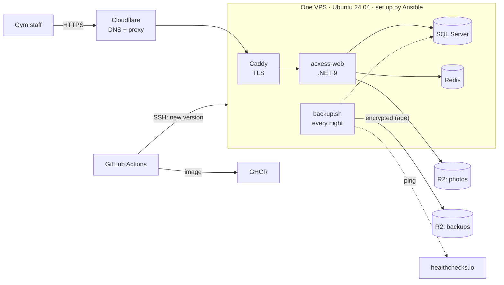

# Acxess


**Acxess** is a multi-tenant web app for gyms. It manages members, subscriptions, payments and expiration reminders. Two real gyms use it every day.

This repository is the source of truth: the app, the server setup, the deploy, the backups and the recovery steps are all here as code or as tested runbooks.

## How it runs



| Area | How it works today | Where |
|---|---|---|
| **App** | .NET 9 modular monolith: 5 modules, each with its own SQL schema. Razor Pages + HTMX + Alpine.js. MediatR pipeline for tenant, logs, idempotency and transactions. | [architecture.md](docs/architecture.md), [`src/`](src) |
| **Server** | One VPS. Docker Compose runs Caddy, the app, a migrator, SQL Server and Redis. | [`src/docker-compose.prod.yml`](src/docker-compose.prod.yml) |
| **Server setup** | One Ansible playbook builds the server from zero: users, SSH, firewall, Docker, app files, `.env`, backup timers. Production was rebuilt with it on 2026-11-27. | [`infrastructure/ansible/`](infrastructure/README.md#ansible) |
| **Secrets** | Ansible Vault, one Vault per environment. GitHub only keeps the SSH key and the server address. | [ADR 0006](docs/adrs/0006-ansible-vault-is-the-only-source-of-secrets.md) |
| **Deploy** | A GitHub Release runs the tests, builds the image and pushes it to GHCR. Then it changes `APP_VERSION` on the server and restarts the app. The migrator runs first. Rollback: deploy an older tag. | [`deploy.yml`](.github/workflows/deploy.yml), [infrastructure.md](docs/infrastructure.md#how-a-change-gets-to-production) |
| **Backups** | Every night: database backup encrypted with age (2 keys) to Cloudflare R2, and a copy of the photos bucket. An alert if a backup fails or does not run. | [infrastructure.md](docs/infrastructure.md#backups-and-recovery) |
| **Recovery** | `ansible-playbook site.yml` + `sudo acxess-restore`. Tested on real servers. | [new-server.md](docs/runbooks/new-server.md) |
| **Decisions** | Why we chose each thing, and its cost. | [ADRs](docs/adrs/) |

## Repository

```
src/
  Acxess.Web/             web host: Razor Pages, startup, pipeline
  modules/                Identity, Catalog, Membership, Billing, Marketing
  shared/                 contracts between modules, shared infrastructure
  docker-compose.yml      local development
  docker-compose.prod.yml production
infrastructure/
  ansible/                server setup: playbook, inventories, variables, Vault
  backup.sh               nightly database backup
  photos-backup.sh        nightly photos copy
  restore.sh              database restore (installed as acxess-restore)
  Caddyfile               HTTPS for production
  lab/, drill/            files only for the lab VM and for recovery drills
docs/                     architecture, infrastructure, ADRs, runbooks
.github/workflows/        CI (pull requests) and CD (releases)
```

## Local development

You need Docker and the [.NET 9 SDK](https://dotnet.microsoft.com/download).

```bash
git clone https://github.com/mendevz/Acxess.git
cd Acxess/src
cp .env.template .env      # then set your local passwords
```

Create `Acxess.Web/appsettings.Localhost.json`:

```json
{
  "ConnectionStrings": {
    "Default": "Data Source=localhost;Database=AcxessDB;User ID=sa;Password={your_password_from_env};Trust Server Certificate=True;"
  }
}
```

Start the database, Redis and the migrations, then the app:

```bash
docker compose up -d acxess-db acxess-redis seq
docker compose up --build acxess-migrator
ASPNETCORE_ENVIRONMENT=Localhost dotnet run --project ./Acxess.Web/
```

More commands (migrations, tests, Tailwind): [docs/development.md](docs/development.md). All documentation: [docs/](docs/README.md).
