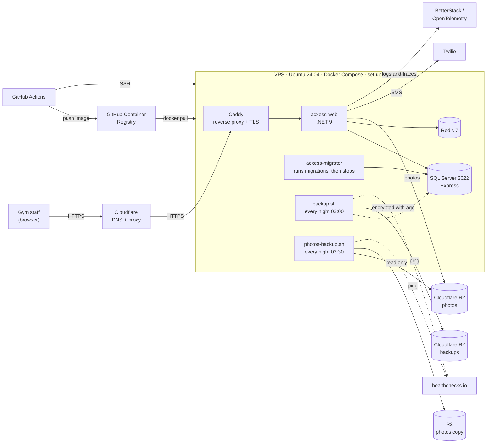
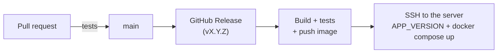

# Infrastructure

How Acxess runs in production, how a change gets there, and how we recover from a failure.

Last checked: 2026-11-27, after production was rebuilt from code.

## The big picture

One small server runs everything. Member photos and backups live outside the server, in Cloudflare R2.

The domain is registered at Namecheap, but its DNS lives in Cloudflare. The web records are **proxied**: users connect to Cloudflare, and Cloudflare connects to the server (SSL mode *Full (strict)*). Users never see the server IP.

## What runs on the server

All services are in [`src/docker-compose.prod.yml`](../src/docker-compose.prod.yml).

| Service | Image | Open to the internet | Data |
|---|---|---|---|
| `caddy` | `caddy:2-alpine` | Yes: 80 and 443 | TLS certificates (volume) |
| `acxess-web` | `ghcr.io/.../acxess-web:<version>` | No (Caddy talks to it) | None. The app is stateless. |
| `acxess-migrator` | Same image as the web app | No | Runs once on each deploy, then stops. |
| `acxess-db` | `mssql/server:2022-latest` | No (localhost only) | Database (volume) |
| `acxess-redis` | `redis:7-alpine` | No | Cache, idempotency keys, sign-in keys (volume) |

Memory limits are set on purpose. The server has about 4 GB of RAM, and SQL Server gets most of it. That is why logs go to a cloud service and not to a container on this server ([ADR 0003](adrs/0003-use-cloud-based-telemetry-for-production.md)).

Outside Docker, on the host: the backup scripts and their systemd timers, `acxess-restore`, `age` and `rclone`. The server time zone is `America/Mexico_City`, so the timers run at Mexico time.

## How a change gets to production

| Step | Where | What happens |
|---|---|---|
| 1 | [`ci-pr.yml`](../.github/workflows/ci-pr.yml) | Every pull request to `main` with code changes runs the unit and integration tests. Changes only in `docs/` or `infrastructure/` skip them. |
| 2 | [`deploy.yml`](../.github/workflows/deploy.yml) | A published GitHub Release starts the deploy. |
| 3 | GitHub Actions | Runs the tests again, builds the Docker image and pushes it to GHCR with the version tag. |
| 4 | GitHub Actions → server | Copies the compose file and the Caddyfile. Changes **only** the `APP_VERSION` line in `.env`. Downloads the image, runs the migrator and starts the new version. |

The deploy never writes secrets. If `.env` does not exist, it stops and asks for an Ansible run ([ADR 0006](adrs/0006-ansible-vault-is-the-only-source-of-secrets.md)).

**Rollback:** run `deploy.yml` by hand (workflow dispatch) with an older version tag.

**Server changes** (users, packages, secrets, backup settings) do not go through a release. You change the code in `infrastructure/ansible/` and run the playbook from `main`.

## Secrets

| Where | What | Who uses it |
|---|---|---|
| `infrastructure/ansible/group_vars/production/vault.yml` | All production secrets: database, Redis, R2 tokens, Twilio, telemetry, GHCR token, healthchecks URLs, admin password hash | Ansible writes them to the server |
| `infrastructure/ansible/group_vars/nonprod/vault.yml` | The same names, with lab values | Lab VM and drills |
| GitHub Secrets | The SSH key of `acxess-deploy` and the server address | `deploy.yml` |
| The project owner, off-line | The Vault passwords and the age private keys | Restore and Ansible runs |

Each Vault has its own password. A production run needs `--vault-id production@<password-file>`.

## Who can access the server

| Account | For | Access |
|---|---|---|
| `acxess-admin` | A person | SSH key with passphrase. Has `sudo` (password) and can read logs (`adm`). |
| `acxess-deploy` | GitHub Actions | Its own SSH key. No password, no `sudo`. Can use Docker and `/opt/acxess`. |
| `acxess-backup` | Nightly backups | Cannot log in. Can read the database container and write backups. |
| `root` | — | SSH login disabled. |

Password login over SSH is disabled for everyone. Steps: [runbooks/server-access.md](runbooks/server-access.md).

Known trade-off: `acxess-deploy` and `acxess-backup` are in the `docker` group, and that is almost the same as `root`. It is accepted for now.

## Backups and recovery

| Data | Where it lives | Backup |
|---|---|---|
| Database | Docker volume on the server | Full backup every night at 03:00 (`WITH CHECKSUM`), encrypted with age, uploaded to R2 with `rclone copy` (never deletes in R2), then checked with `rclone check`. Local copies: 7 days. |
| Member photos | Cloudflare R2 | Copied every night at 03:30 to a private bucket. The token for the photos bucket can only **read**. |
| Configuration and secrets | This repository (Vault encrypted) | Git history. |
| Redis | Docker volume | No backup. It holds idempotency keys and the sign-in keys. If they are lost, users sign in again ([ADR 0005](adrs/0005-keep-data-protection-keys-in-redis.md)). |

- **Two age keys.** Every backup opens with the main key **or** with an emergency key that only exists on paper. Losing one laptop does not lose the backups.
- **The private keys are not on the server.** Someone with access to the server cannot read old backups.
- **Alerts.** Each backup pings [healthchecks.io](https://healthchecks.io) when it works and `/fail` when it does not. If no ping arrives at the expected time, healthchecks also sends an alert.

Recovery runbooks: [new server](runbooks/new-server.md) and [restore the database](runbooks/restore-database.md). Scripts: [infrastructure/README.md](../infrastructure/README.md#scripts).

### Measured

| What | Result | Date |
|---|---|---|
| Server reboot: time until the app works again | About 3 minutes, no manual steps | 2026-11-07 |
| Database restore with `restore.sh` (lab, 10 MB backup) | 14 s, from the command to the app answering | 2026-11-19 |
| Full recovery from an empty server (lab VM, without DNS) | 5 min 38 s | 2026-11-19 |
| Full recovery on a real VPS (same type as production) with Cloudflare and Let's Encrypt | 10 min 58 s | 2026-11-24 |
| **Production rebuilt from code**: last backup with the app stopped, snapshot, reinstall, Ansible, restore, sign in | **16 min 16 s**, no data lost. 7 min of it: the old server had no SSH key for `root`. | 2026-11-27 |
| Data we can lose (RPO) | Up to 24 hours (one backup per night) | — |

## Server setup as code

The server setup is an Ansible playbook: [`infrastructure/ansible/site.yml`](../infrastructure/ansible/site.yml). It creates the users, hardens SSH, sets the firewall and the time zone, installs Docker, writes the app files and `.env`, installs the backup tools and timers, and installs `acxess-restore`.

It runs on three environments, each with its own inventory and variables: the lab VM, the recovery drills, and production. A second run gives `changed=0`: the server already matches the code. How to run it: [`infrastructure/README.md`](../infrastructure/README.md#ansible).

## How we got here

| Before | Now | Why |
|---|---|---|
| SSH as `root` with a password | Admin user and a deploy user, keys only | Stop brute-force attacks. Give CI only what it needs. |
| Server set up by hand | Built by Ansible (production since 2026-11-27) | Rebuild a server from code, not from memory. |
| Secrets in GitHub Secrets **and** in Ansible | Ansible Vault only, one Vault per environment | One owner for each value ([ADR 0006](adrs/0006-ansible-vault-is-the-only-source-of-secrets.md)). |
| Backup not encrypted, `rclone sync`, no alerts, run by `root` | Encrypted for 2 keys, `copy` + `check`, alerts, own user | A backup must be private, safe from deletes, and watched. |
| Photos without backup | Nightly copy with a read-only token | Photos were in one place only. |
| Restore never tested | `restore.sh`, tested in the lab, on drills and in production | A backup that was never restored is only a hope. |
| Database log grew all the time (`FULL` recovery model) | `SIMPLE` recovery model | `FULL` only helps with log backups. We take full backups. |

## What is next

1. Create the server with code too (Terraform): type, location, image and SSH key.
2. A second backup copy with another provider (today everything is in Cloudflare R2).
3. Allow ports 80 and 443 only from Cloudflare (Hetzner firewall).
4. An uptime monitor: today nobody is warned if the app goes down.
