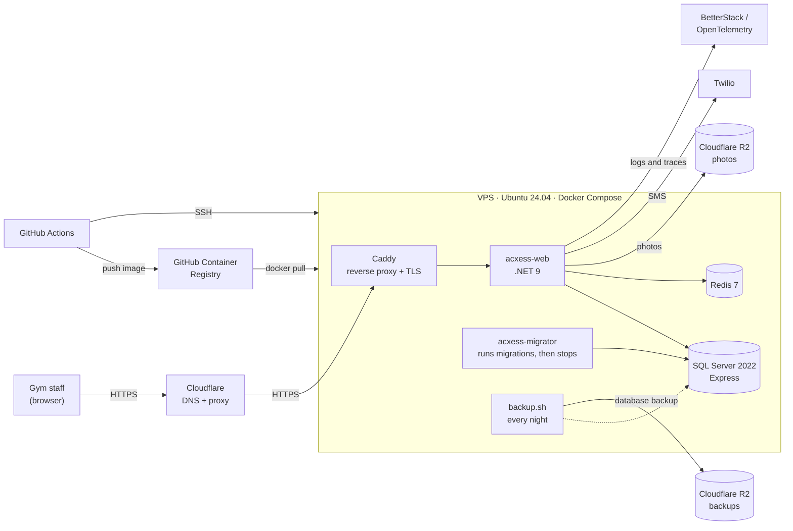
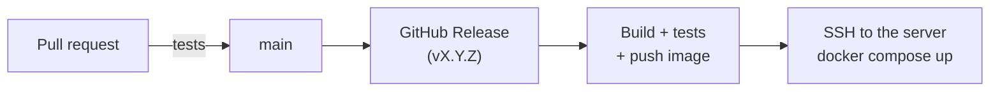

# Infrastructure

How Acxess runs in production, how a change gets there, and how we recover from a failure.

Last checked: 2026-11-19.

## The big picture

One small server runs everything. Files (member photos) and backups live outside the server, in Cloudflare R2.

The domain is registered at Namecheap, but its DNS lives in Cloudflare. The web records are **proxied**: users connect to Cloudflare, and Cloudflare connects to the server. Users never see the server IP.

## What runs on the server

All services are in [`src/docker-compose.prod.yml`](../src/docker-compose.prod.yml).

| Service | Image | Open to the internet | Data |
|---|---|---|---|
| `caddy` | `caddy:2-alpine` | Yes: 80 and 443 | TLS certificates (volume) |
| `acxess-web` | `ghcr.io/.../acxess-web:<version>` | No (Caddy talks to it) | None. The app is stateless. |
| `acxess-migrator` | Same image as the web app | No | Runs once on each deploy, then stops. |
| `acxess-db` | `mssql/server:2022-latest` | No (localhost only) | Database (volume) |
| `acxess-redis` | `redis:7-alpine` | No | Cache and idempotency keys (volume) |

Memory limits are set on purpose. The server has about 4 GB of RAM, and SQL Server gets most of it. That is why logs go to a cloud service and not to a container on this server ([ADR 0003](adrs/0003-use-cloud-based-telemetry-for-production.md)).

## How a change gets to production

| Step | Where | What happens |
|---|---|---|
| 1 | [`ci-pr.yml`](../.github/workflows/ci-pr.yml) | Every pull request to `main` with code changes runs the unit and integration tests. Changes only in `docs/` or `infrastructure/` skip them. |
| 2 | [`deploy.yml`](../.github/workflows/deploy.yml) | A published GitHub Release starts the deploy. |
| 3 | GitHub Actions | Runs the tests again, builds the Docker image and pushes it to GHCR with the version tag. |
| 4 | GitHub Actions → server | Copies the compose file and scripts, writes `.env` from GitHub Secrets, runs the migrator and starts the new version. |

**Rollback:** run `deploy.yml` by hand (workflow dispatch) with an older version tag. The image already exists in GHCR, so there is no new build.

## Who can access the server

| Account | For | Access |
|---|---|---|
| Admin user | A person | SSH key with passphrase. Has `sudo`. |
| `acxess-deploy` | GitHub Actions | Its own SSH key. No password, no `sudo`. Can use Docker and `/opt/acxess`. |
| `acxess-backup` | Nightly backup (new design) | Cannot log in. Can read the database container and write backups. |
| `root` | — | SSH login disabled. |

Password login over SSH is disabled for everyone. Steps: [runbooks/server-access.md](runbooks/server-access.md).

Known trade-off: `acxess-deploy` and `acxess-backup` are in the `docker` group, and that is almost the same as `root`. It is accepted for now, and an ADR will explain why.

## Backups and recovery

| Data | Where it lives | Backup |
|---|---|---|
| Database | Docker volume on the server | Full backup every night at 03:00, uploaded to Cloudflare R2. |
| Member photos | Cloudflare R2 | New design: copied every night to a second bucket. |
| Configuration | This repository + GitHub Secrets | Git history. |
| Redis | Docker volume | No backup. It holds idempotency keys and the ASP.NET Data Protection keys. If they are lost, users must sign in again. They stay in Redis on purpose ([ADR 0005](adrs/0005-keep-data-protection-keys-in-redis.md)). |

### Production today vs. new design

Production still uses the first version, [`infrastructure/backup.sh`](../infrastructure/backup.sh). The new design is built and tested in a lab virtual machine. It goes to production **only after a full restore test** passes.

| | Production today (`backup.sh`) | New design (`backup-v2.sh`, tested in the lab) |
|---|---|---|
| Encryption | No | Yes, with [age](https://age-encryption.org). The private key is **not** on the server. |
| Upload | `rclone sync` (a deleted file is also deleted in R2) | `rclone copy` (never deletes in R2) |
| Check after upload | No | `rclone check` before old local files are removed |
| Runs as | `root` (cron) | `acxess-backup` (systemd timer) |
| Alert if it fails or does not run | No | Yes ([healthchecks.io](https://healthchecks.io)) |
| Photos | Not copied | Copied to a second bucket. The backup token can only **read** the original photos. |
| Restore tested | No | Yes, with [`restore.sh`](../infrastructure/restore.sh) ([runbook](runbooks/restore-database.md)) |

Recovery runbooks: [new server](runbooks/new-server.md) and [restore the database](runbooks/restore-database.md).

### Measured so far

| What | Result | Date |
|---|---|---|
| Server reboot: time until the app works again | About 3 minutes, no manual steps | 2026-11-07 |
| Database restore with `restore.sh` (lab, 10 MB backup) | 14 s, from the command to the app answering | 2026-11-19 |
| Full recovery from an empty server: new VM, `ansible-playbook site.yml`, `acxess-restore`, sign in (lab, without DNS) | 5 min 38 s, from "the server is dead" to "I can sign in". About 4 min of machine time. | 2026-11-19 |
| Data lost in that test (RPO) | Only the changes after the last backup. A test member created after the backup was missing, as expected. | 2026-11-19 |
| Data we can lose (RPO) | Up to 24 hours (one backup per night) | — |

## Server setup as code

The server setup is an Ansible playbook: [`infrastructure/ansible/site.yml`](../infrastructure/ansible/site.yml). It creates the users, hardens SSH, sets the firewall, installs Docker and the backup tools, and installs the backup timers. Secrets are encrypted with Ansible Vault.

Tested in a lab virtual machine: on an empty machine the first run makes all the changes, and the second run makes **0** changes. Zero changes means the server already matches the code.

It is not applied to production yet. How to run it: [`infrastructure/README.md`](../infrastructure/README.md).

## How we got here

| Before | Now | Why |
|---|---|---|
| SSH as `root` with a password | Personal admin user and a separate deploy user, keys only | Stop brute-force attacks. Give CI only what it needs. |
| Database password inside `backup.sh` | Password in `.env` on the server | Secrets do not belong in Git. |
| Server set up by hand | Ansible playbook (lab) | Rebuild a server from code, not from memory. |
| Backup without encryption, `sync`, no alerts | Encrypted, `copy`, check, alerts (lab) | A backup must be private, safe from deletes, and watched. |
| Photos without backup | Nightly copy with a read-only token (lab) | Photos were in one place only. |
| Restore never tested | `restore.sh`, tested with a real backup (lab) | A backup that was never restored is only a hope. |
| Database log grew all the time (`FULL` recovery model, but no log backups) | `SIMPLE` recovery model: log from 328 MB to 72 MB (production) | `FULL` only helps with log backups. We take full backups. |

## What is next

1. The same test on a real, temporary VPS: real DNS change and a Let's Encrypt certificate.
2. Move production to the new backup design.
3. A second backup copy with another provider (today everything is in Cloudflare R2).
