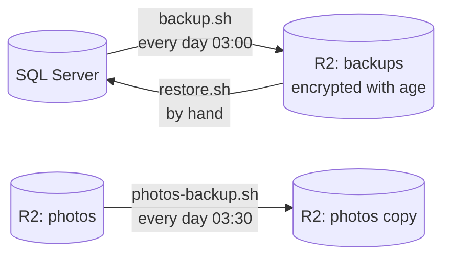

# infrastructure/

Everything needed to set up and run the Acxess server. For the big picture, read [docs/infrastructure.md](../docs/infrastructure.md) first.

## What is here

| Path | What it is | Used by |
|---|---|---|
| `ansible/` | Server setup as code | You, from your machine |
| `backup.sh` | Nightly database backup: encrypted, checked, with alerts | Ansible installs it |
| `photos-backup.sh` | Copies the photos bucket to a backup bucket | Ansible installs it |
| `restore.sh` | Restores the database from R2 and starts the app | Ansible installs it as `acxess-restore` |
| `Caddyfile` | Reverse proxy and HTTPS for production | Ansible and `deploy.yml` |
| `lab/` | Lab-only files: Caddyfile with a local certificate, Compose override that blocks logs to production | Ansible, only on the lab VM and drills |
| `drill/` | Caddyfile for drills on a real VPS (`basic_auth`) | Ansible, only on drills |
| `lab/cloud-init.yaml` | Creates the lab virtual machine | Multipass |
| `scripts/inventory-server.sh` | Read-only report of a server (users, ports, services) | You, before changing a server |

**Careful:** `deploy.yml` copies `Caddyfile` and `src/docker-compose.prod.yml` to production on **every release**. A change in these files goes to production with the next release.

## Scripts

All scripts stop at the first error (`set -euo pipefail`). Each one starts with a header: what it does, how to run it, its config and its exit code.



### `backup.sh`: database backup

| | |
|---|---|
| Runs | Every day at 03:00 (Mexico time). systemd timer `acxess-backup.timer`, user `acxess-backup`. |
| Steps | Full backup `WITH CHECKSUM` → encrypt with age for every key in `age-recipients.txt` → `rclone copy` to R2 → `rclone check` → delete local copies older than 7 days |
| Config | `/opt/acxess-backup/.env` and `/opt/acxess-backup/age-recipients.txt` (from Ansible) |
| Alerts | [healthchecks.io](https://healthchecks.io): a ping when it works, `/fail` when not. No ping at all also creates an alert. |
| File names | `acxess_YYYY-MM-DD_HH-MM-SS.bak.age`. Alphabetical order is also date order. |

```bash
sudo systemctl start acxess-backup.service        # run it now
journalctl -u acxess-backup.service -n 30          # see the result
systemctl list-timers 'acxess-*'                  # next run
```

Only the age **public** keys are on the server. Someone with access to the server cannot read old backups.

### `photos-backup.sh`: photos backup

| | |
|---|---|
| Runs | Every day at 03:30. systemd timer `acxess-photos-backup.timer`, user `acxess-backup`. |
| Steps | `rclone copy` from the photos bucket to the backup bucket → `rclone check` |
| Access | Two tokens. The token for the photos bucket can only **read**, so this script cannot delete a real photo. |
| Alerts | healthchecks.io, its own check |

```bash
sudo systemctl start acxess-photos-backup.service
journalctl -u acxess-photos-backup.service -n 30
```

### `restore.sh`: database restore

| | |
|---|---|
| Runs | By hand, as root: `sudo acxess-restore /dev/shm/<age-key> [backup-file-name]` |
| Needs | `ansible-playbook site.yml` applied, and an age **private** key copied to `/dev/shm` |
| Steps | Choose the newest backup (or the one you name) → download all images → decrypt into the container → `VERIFYONLY` → stop the web app → `RESTORE` + `CHECKSUM` → `DBCC CHECKDB` → start the app → wait until it answers |
| Safety | All checks and downloads run **before** the app stops. If the key or the backup is bad, the app keeps running. |
| Output | The time of each step. We use it to measure the recovery time. |

Why `/dev/shm`: it is memory, not disk. The key is never written to the server disk, and the script deletes it right after it decrypts the backup.

Step by step: [docs/runbooks/restore-database.md](../docs/runbooks/restore-database.md).

## Ansible

### Requirements

- Ansible (tested with `ansible-core` 2.20)
- The collections: `ansible-galaxy collection install -r requirements.yml`
- The Vault passwords (not in Git): `~/.ansible-vault-pass` (lab and drills) and a separate file for production
- SSH access to the target server

### Environments

| Environment | Inventory | Variables | Command |
|---|---|---|---|
| Lab VM | `inventory.ini` (the default) | `group_vars/nonprod/` | `ansible-playbook site.yml` |
| Drill on a VPS | `inventory-drill.ini` (IP from `NEW_IP`) | `group_vars/nonprod/` | `ansible-playbook -i inventory-drill.ini site.yml` |
| Production | `inventory-production.ini` (SSH alias `acxess-prod`) | `group_vars/production/` | `ansible-playbook -i inventory-production.ini --vault-id production@<password-file> site.yml` |

Without `-i`, Ansible always uses the lab. Production also needs its own Vault password, so a production run cannot happen by mistake. The playbook stops if a production server gets lab settings (`Check production safety`).

The first run on a new server connects as `root`. After it, `root` cannot log in. Later runs use the admin user:

```bash
ansible-playbook -i <inventory> site.yml -e ansible_user=acxess-admin -K
```

### Run it

Run the commands **inside** `infrastructure/ansible/`. Ansible reads `ansible.cfg` from the current folder, and that file sets the default inventory and the lab Vault password file.

```bash
cd infrastructure/ansible
ansible-playbook site.yml --check --diff   # show what would change, change nothing
ansible-playbook site.yml                  # apply
ansible-playbook site.yml                  # run again: expect changed=0
```

For production, always run it from `main`, up to date: `deploy.yml` copies files from `main` too.

### Files

| File | What it is |
|---|---|
| `site.yml` | The playbook: users, SSH, firewall, time zone, Docker, app files and `.env`, backup tools and timers, restore script |
| `inventory*.ini` | Which server, and how to connect. One file per environment. |
| `group_vars/all/vars.yml` | Settings for every environment: the age public keys, the time zone, paths |
| `group_vars/nonprod/` | Lab and drill values (`vars.yml`) and secrets (`vault.yml`) |
| `group_vars/production/` | Production values (`vars.yml`) and secrets (`vault.yml`, its own password) |
| `files/acxess-prod-deploy.pub` | Public SSH key of GitHub Actions, for `acxess-deploy` in production |
| `templates/` | Files that Ansible fills in and copies to the server (`.env`, rclone config, systemd units, age recipients) |

Edit the secrets with:

```bash
EDITOR=nano ansible-vault edit group_vars/nonprod/vault.yml
EDITOR=nano ansible-vault edit --vault-id production@<password-file> group_vars/production/vault.yml
```

### The app version

`deploy.yml` owns `APP_VERSION` in `/opt/acxess/.env`. Ansible keeps the version that the server already has. It only writes `app_version` from the variables on an **empty** server. When you rebuild production, pass the last release: `-e app_version=vX.Y.Z`.

### Lab only

`network_mtu` in `inventory.ini` fixes a network problem of the lab machine. The task runs only when the variable exists.

## Lab virtual machine

```bash
multipass launch 24.04 --name acxess-lab --cpus 2 --memory 4G --disk 20G \
  --cloud-init infrastructure/lab/cloud-init.yaml --timeout 600
```

Same Ubuntu version as production. The lab VM copies production on purpose (for example, password login is on) so the playbook can be tested before it touches a real server.
