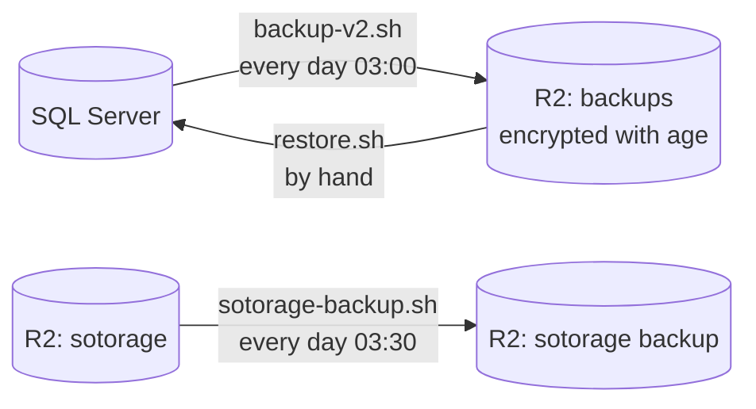

# infrastructure/

Everything needed to set up and run the Acxess server. For the big picture, read [docs/infrastructure.md](../docs/infrastructure.md) first.

## What is here

| Path | What it is | Used by |
|---|---|---|
| `Caddyfile` | Reverse proxy and HTTPS config | `deploy.yml` copies it to production |
| `backup.sh` | Current production database backup | `deploy.yml` copies it to production |
| `backup-v2.sh` | New database backup: encrypted, checked, with alerts | Ansible (lab). Replaces `backup.sh` in production later. |
| `photos-backup.sh` | Copies the photos bucket to a backup bucket | Ansible (lab) |
| `restore.sh` | Restores the database from R2 and starts the app | Ansible (lab), installed as `acxess-restore` |
| `lab/` | Lab-only files: Caddyfile with a local certificate, Compose override | Ansible, only on servers in the `lab` group |
| `ansible/` | Server setup as code | You, from your machine |
| `lab/cloud-init.yaml` | Creates the lab virtual machine | Multipass |
| `scripts/inventory-server.sh` | Read-only report of a server (users, ports, services) | You, before changing a server |

**Careful:** `deploy.yml` copies `backup.sh` and `Caddyfile` to production on **every release**. A change in these two files goes to production with the next release. New scripts use other names until they are ready.

## Scripts

All scripts stop at the first error (`set -euo pipefail`). Each one starts with a header: what it does, how to run it, its config and its exit code.



### `backup-v2.sh`: database backup

| | |
|---|---|
| Runs | Every day at 03:00. systemd timer `acxess-backup.timer`, user `acxess-backup`. |
| Steps | Full backup `WITH CHECKSUM` → encrypt with age → `rclone copy` to R2 → `rclone check` → delete local copies older than 7 days |
| Config | `/opt/acxess-backup/.env` (from Ansible and the Vault) |
| Alerts | [healthchecks.io](https://healthchecks.io): a ping when it works, `/fail` when not. No ping at all also creates an alert. |
| File names | `acxess_YYYY-MM-DD_HH-MM-SS.bak.age`. Alphabetical order is also date order. |

```bash
sudo systemctl start acxess-backup.service        # run it now
journalctl -u acxess-backup.service -n 30          # see the result
systemctl list-timers 'acxess-*'                  # next run
```

Only the age **public** key is on the server. Someone with access to the server cannot read old backups.

### `photos-backup.sh`: photos backup

| | |
|---|---|
| Runs | Every day at 03:30. systemd timer `acxess-photos-backup.timer`, user `acxess-backup`. |
| Steps | `rclone copy` from the photos bucket to the backup bucket → `rclone check` |
| Access | Two tokens. The token for the photos bucket can only **read**, so this script cannot delete a real photo. |
| Alerts | healthchecks.io, its own check |

```bash
sudo systemctl start acxess-photos-backup.service
journalctl -u acxess-photos-backup.service -n 30
```

### `restore.sh`: database restore

| | |
|---|---|
| Runs | By hand, as root: `sudo acxess-restore /dev/shm/<age-key> [backup-file-name]` |
| Needs | `ansible-playbook site.yml` applied, and the age **private** key copied to `/dev/shm` |
| Steps | Choose the newest backup → decrypt into the container → `VERIFYONLY` → stop the web app → `RESTORE` + `CHECKSUM` → `DBCC CHECKDB` → start the app → wait until it answers |
| Safety | All checks run **before** the app stops. If the key or the backup is bad, the app keeps running. |
| Output | The time of each step. We use it to measure the RTO. |

Why `/dev/shm`: it is memory, not disk. The key is never written to the server disk, and the script deletes it right after it decrypts the backup.

Why `/usr/local/sbin` and owner `root`: root runs this script. If another user could edit it, that user could run anything as root.

Step by step: [docs/runbooks/restore-database.md](../docs/runbooks/restore-database.md).

## Ansible

### Requirements

- Ansible (tested with `ansible-core` 2.20)
- The collections: `ansible-galaxy collection install -r requirements.yml`
- The Vault password in `~/.ansible-vault-pass` (not in Git)
- SSH access to the target server

### Run it

Run the commands **inside** `infrastructure/ansible/`. Ansible reads `ansible.cfg` from the current folder, and that file sets the inventory and the Vault password file. From another folder, Ansible does not find them.

```bash
cd infrastructure/ansible
ansible-playbook site.yml --check --diff   # show what would change, change nothing
ansible-playbook site.yml                  # apply
ansible-playbook site.yml                  # run again: expect changed=0
```

### Files

| File | What it is |
|---|---|
| `site.yml` | The playbook: users, SSH, firewall, Docker, app files and `.env`, backup tools and timers, restore script |
| `inventory.ini` | Which servers, and how to connect. Today: the lab VM only. |
| `group_vars/all/vars.yml` | Normal settings (bucket names, paths, public age key) |
| `group_vars/all/vault.yml` | Secrets, encrypted with Ansible Vault |
| `templates/` | Files that Ansible fills in and copies to the server (`.env`, rclone config, systemd units) |

Edit the secrets with:

```bash
EDITOR=nano ansible-vault edit group_vars/all/vault.yml
```

### Lab only

`network_mtu` in `inventory.ini` fixes a network problem of the lab machine. The task runs only when the variable exists, so production is not affected.

## Lab virtual machine

```bash
multipass launch 24.04 --name acxess-lab --cpus 2 --memory 4G --disk 20G \
  --cloud-init infrastructure/lab/cloud-init.yaml --timeout 600
```

Same Ubuntu version as production. The lab VM copies production on purpose (for example, password login is on) so the playbook can be tested before it touches a real server.
